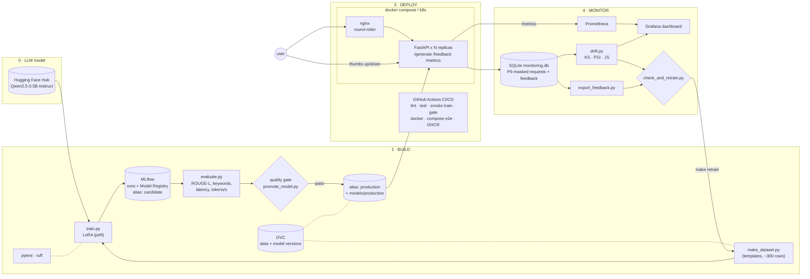

# llmops-lab

A complete, **free, local** LLMOps pipeline: fine-tune a small open model (LoRA), track and gate it with MLflow,
serve it with FastAPI behind nginx, and monitor it with Prometheus, Grafana, drift detection and a feedback loop.

* No paid APIs, no API keys, no cloud accounts. Only open-source tools, versions pinned.
* Runs on a laptop CPU (8 GB RAM). A GPU is auto-detected and used if present.
* Task: a customer-support assistant for a fictional file-sync product, **AuroraSync**. Base model: `Qwen/Qwen2.5-0.5B-Instruct`.

## Architecture



(Stage 2, **Manage**, is the glue: `Makefile`, `configs/config.yaml` as the single source of truth, JSON logging, versioned prompts `prompts/v1.txt`, `v2.txt`.)

## Hardware requirements

| | Minimum | Comfortable |
|---|---|---|
| RAM | 8 GB (`API_REPLICAS=1`) | 16 GB (2 replicas + monitoring stack) |
| CPU | 4 cores | 8 cores |
| Disk | ~6 GB (model 1 GB, Python deps ~2.5 GB, Docker images) | 10 GB |
| GPU | optional, auto-detected | |
| Time (CPU) | `make train-smoke` ≈ 3-10 min · `make train` ≈ 30-60 min · eval ≈ 1-6 min | |

The first run needs internet once to download the model and Python packages; everything after is local.

## Quickstart (clone to a running system)

Needs Python 3.11, git and make. Docker is only needed for step 6.

```bash
git clone <your-repo-url> llmops-lab && cd llmops-lab
make setup            # .venv, pinned deps (CPU torch), git + DVC init
source .venv/bin/activate
make data             # synthetic dataset -> data/train.jsonl, data/val.jsonl (+ DVC version)
make download-model   # caches Qwen2.5-0.5B-Instruct in models/hf_cache
make train-smoke      # LoRA, 20 steps; registers a model version with alias "candidate" in MLflow
make eval-smoke       # reports/eval.json
make promote          # quality gate: candidate -> production (exit 1 if it fails)
make test && make lint
make serve            # API on http://localhost:8000  (chat UI at /)
# in another terminal:
curl localhost:8000/health
curl -X POST localhost:8000/generate -H 'Content-Type: application/json' \
     -d '{"prompt":"How do I reset my password?","max_new_tokens":64,"temperature":0}'
# 6. the full stack (2 replicas + nginx + MLflow + Prometheus + Grafana)
make up               # then open the URLs below.  `make down` to stop.
```

For a real (non-smoke) model run `make train && make eval && make promote`.
`make all` runs the smoke pipeline end to end (`data → download-model → train-smoke → eval-smoke → promote → test`).

### No local machine? Use GitHub Actions (free)

Push the folder to a GitHub repo. `.github/workflows/ci.yml` runs the whole pipeline on a free runner: lint, tests,
dataset, smoke training, evaluation, quality gate, **serving + simulated traffic + feedback + drift report**, a Docker
container smoke test, and the full compose stack (2 replicas behind nginx, Prometheus targets, Grafana). Download the
`reports` and `production-model` artifacts from the run page. Tag `v1.0.0` to publish the image to GHCR (`cd.yml`).

## URLs

| What | URL |
|---|---|
| API / chat UI (`make serve`) | http://localhost:8000 · Swagger at `/docs` |
| API through nginx (`make up`) | http://localhost:8080 |
| MLflow (runs, Model Registry) | http://localhost:5000 |
| Prometheus | http://localhost:9090 |
| Grafana (admin / admin, anonymous viewer enabled) | http://localhost:3000 → dashboard "llmops-lab: LLM service overview" |

## Demo each stage

**Build.** `make data` → `make train-smoke` → open MLflow: loss curves, params (prompt version, LoRA config, data hash),
and *Models → llmops-lab-support* with the `candidate` alias. `make eval-smoke && make promote` moves the alias to
`production` only if `configs/config.yaml → gate` is met and the candidate is not worse than the current production
model (tolerance `max_regression`). To see the gate refuse, set `gate.smoke_thresholds.min_rouge_l: 0.99` and re-run
`make promote` (exit code 1, reasons printed). Compare with the untouched model: `python -m src.evaluate --model base --out reports/eval_base.json --no-log --smoke`.
Switch prompt templates with `PROMPT_VERSION=v2 make train-smoke`.

**Manage / Deploy.** `make up`, then
```bash
for i in $(seq 1 10); do curl -s localhost:8080/health; echo; done | sort | uniq -c     # two different "instance" values
docker compose up -d --scale api=3                                                       # scale; nginx re-resolves DNS automatically
```
Kubernetes (kind or minikube): `docker build -t llmops-lab-api:local . && kind load docker-image llmops-lab-api:local`
(minikube: `minikube image load llmops-lab-api:local`), then `make k8s-apply` (= `kubectl apply -k k8s/`),
`kubectl port-forward svc/llm-api 8000:80`. The HPA needs metrics-server (`minikube addons enable metrics-server`).

**Monitor.**
```bash
python scripts/simulate_traffic.py --url http://localhost:8000 --normal 20 --shifted 10   # (8080 for compose)
curl -s localhost:8000/metrics | grep ^llm_
make drift            # reports/drift.html (open it) + reports/drift.json -> llm_drift_score gauge
python scripts/check_and_retrain.py --dry-run
```
Submit feedback with the 👍/👎 buttons in the chat UI at `/`, or `POST /feedback {"request_id": ..., "rating": "up"|"down"}`.
No model available but want to see drift? `python scripts/simulate_traffic.py --direct-db --normal 40 --shifted 40 && make drift`.

**Feedback loop.** `make retrain` = export feedback → merge into the training set (new DVC version) → train → eval → gate →
promote (`make retrain TRAIN_ARGS=--smoke EVAL_ARGS=--smoke` for a quick pass). `make check-retrain` does the same, but
only when drift score ≥ 0.40 or ≥ 40 % negative feedback (with ≥ 10 votes). Restart the API to load the new production model
(`docker compose restart api`).

## Design notes

* **What is registered?** The LoRA adapter (a few MB), not the 1 GB base model. The API loads base + adapter and merges them.
  `python -m src.train --merge` also writes a full merged model to `models/merged/`.
* **Model resolution** (`src/model_io.py`): registry alias `production` → `models/production/` (written by the promote step)
  → base model. The API always starts; `/ready` reports 503 until the model has loaded.
* **Registry in Docker.** Registry rows hold host paths. The API re-anchors them at the mounted `./mlruns`; if that fails it uses `models/production`.
* **Drift** (`src/monitor/drift.py`): KS test on prompt length, PSI + Jensen-Shannon on token distribution, combined into a
  0-1 score. PSI is *bias-corrected* for small windows: without that, raw PSI raised false alarms on 20-40 prompt windows in my
  tests. `tests/test_drift.py` checks zero false alarms over 45 random windows and detection of shifted/contaminated traffic.
  An extra Evidently report is written if you `pip install -r requirements-extra.txt`.
* **Privacy.** Emails and phone numbers are masked before anything reaches SQLite (`src/utils/pii.py`). The product's own support address is kept.
* **Dataset caveat.** Data is template-generated, so validation measures how well the model learned the templates, not open-ended generalisation.

## Troubleshooting

| Symptom | Fix |
|---|---|
| `pip` cannot find `torch==2.4.1` | Use Python 3.11 (3.12 works for 2.4.1 too, 3.13 does not). The CPU wheel index is already in `requirements-serve.txt`. |
| Training is slow / out of memory | Use `--smoke`, close other apps, lower `train.full.batch_size` / `max_seq_len` in `configs/config.yaml`. |
| `make promote` exits 1 | Intended: the gate failed; read `reports/promotion.json`. Exit 2 means eval.json is stale: re-run `make eval`. |
| `/ready` stays 503 | `curl localhost:8000/ready` shows `error`. Usually the first model download (needs internet) is still running or failed. |
| Compose: API unhealthy for minutes | Model loading on first start; check `docker compose logs api`. Use `API_REPLICAS=1 make up` on 8 GB RAM. |
| `permission denied` on `data/` or `models/` in Docker | Start with `make up` (creates folders and passes your uid); on Windows/macOS run it from WSL2/a normal shell. |
| MLflow UI empty in compose | The compose MLflow reads `./mlflow.db`: run training from the repo root first (`make train-smoke`). |
| nginx only hits one replica | Wait ~10 s after scaling (DNS refresh); verify with `docker compose ps`. |
| DVC warnings | DVC is best-effort; the pipeline continues without it (`pip install dvc==3.55.2`). |

## What I'd improve for production

* Replace SQLite with Postgres (concurrent writers) and ship request logs through a queue; move MLflow to Postgres + object storage.
* Serve with a real inference engine (vLLM / llama.cpp / TGI), batching and streaming; autoscale on queue depth, not CPU.
* Human review before thumbs-up responses become training data; deduplicate and score them (they can reinforce errors).
* LLM-specific evaluation (LLM-as-judge or human eval, safety/red-team sets), a held-out test set independent of templates, canary/shadow rollout instead of an in-place alias flip.
* Hot model reload (`/reload`) without restarts; signed model artifacts; secrets management; auth and rate limiting on the API; TLS at the edge.
* Embedding-based drift (not just lexical), scheduled drift/retrain jobs (cron/Argo), alerting rules in Prometheus/Alertmanager, tracing with OpenTelemetry.
* Real PII detection (e.g. Presidio) rather than two regexes; retention policy on logged prompts.

## Command reference

| Command | Purpose |
|---|---|
| `make setup` | venv, deps, git + DVC init |
| `make data` | generate dataset, version it |
| `make download-model` | cache base model |
| `make train` / `make train-smoke` | LoRA fine-tune (full / 20-step) → registry alias `candidate` |
| `make eval` / `make eval-smoke` | evaluate candidate → `reports/eval.json` |
| `make promote` | quality gate → alias `production` + `models/production` |
| `make test` / `make lint` | pytest / ruff |
| `make serve` | run API locally |
| `make up` / `make down` | compose stack (`API_REPLICAS=N`) |
| `make drift` | drift report |
| `make simulate SIM_ARGS="..."` | normal + shifted traffic |
| `make retrain` | feedback → data → train → eval → gate → promote |
| `make check-retrain ARGS=--dry-run` | drift/feedback-triggered retraining |
| `make all` | smoke pipeline |
